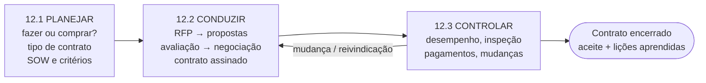
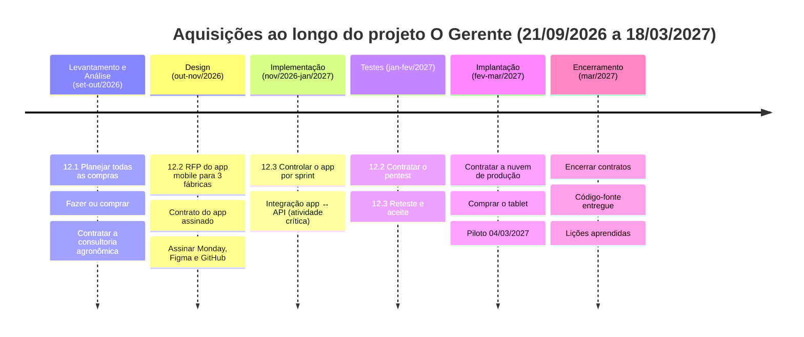

# Gerenciamento de Aquisições — Estudo aplicado ao projeto "O Gerente"

**Matéria:** Gerenciamento de Software · Prof. Marcelo Tadeu Boer · UNIFEF
**Grupo:** Lucas Mendes, Rhiady Vieira, João Augusto, Jhonatan Zago
**Limite:** até 15 slides / 10 a 15 min
**Base teórica:** Guia PMBOK 6ª ed. (PMI, 2017), cap. 12
**Complementa:** `pesquisa-gerenciamento-aquisicoes.md`, que continua sendo a base teórica. Este arquivo transforma a teoria em uma história que o grupo já conhece.

---

## 0. A ideia central (leia isto primeiro)

A dificuldade hoje é explicar a teoria de forma dinâmica. A solução é **contar uma história em vez de recitar conceitos**.

> **Nós somos a empresa que vai construir "O Gerente" para o Seu Ricardo.**
> Para entregar o sistema, a gente precisa **comprar** algumas coisas que não faz sozinho.
> Cada conceito de aquisições aparece quando a gente precisa dele na história.

Por que funciona:
- O projeto é de vocês: o cronograma de 53 atividades, a stack (Angular, Spring Boot, PostgreSQL, Docker) e o cliente foram todos montados pelo grupo. Fica fácil falar sem decorar.
- Cada slide abre com uma **cena** ("o Luciano está no talhão sem internet…") e só depois dá o **nome técnico** ("isso é uma análise fazer-ou-comprar"). É o mesmo princípio do projeto de Processos de Fabricação, mas com menos animação.
- O HealthCare.gov continua na apresentação, mas reduzido a um contraponto: **"isto é o que acontece quando dá errado em escala gigante"**.

**Lembrete do cenário (repositório `trabalho-boer`):**
- **Cliente:** Seu Ricardo, produtor de laranja em Urânia-SP, com 12 alqueires (~29 ha) e fruta vendida no pé.
- **Equipe dele:** o funcionário Luciano, uma agrônoma e diaristas na colheita.
- **Dores:** gastos que escapam (diesel, peças, consertos), receita incerta, estoque de insumos sem saldo confiável e nenhum histórico de aplicações de defensivos.
- **Sistema:** 8 módulos (propriedades e talhões, atividades, estoque, aplicações fitossanitárias, colheitas e custos, painel, perfis de acesso e regras de negócio).
- **Cronograma:** 21/09/2026 a 18/03/2027, em 7 fases, com piloto em 04/03/2027.
- **Regra de negócio-símbolo:** aplicar 40 L de fungicida com 20 L em estoque é bloqueado ("saldo insuficiente").

---

## 1. Conceito e papel no projeto

### Teoria (curta)
- **PMBOK 6:** o Gerenciamento das Aquisições inclui os processos necessários para comprar ou adquirir produtos, serviços ou resultados de **fora da equipe do projeto**.
- O PMBOK olha tudo pelo lado de **quem compra**, e é exatamente o nosso lado na história.
- O documento central é o **contrato** (ou acordo), que liga o projeto ao fornecedor.
- A área conversa com todas as outras: escopo (o que comprar), custo (quanto), cronograma (quando), qualidade (critério de aceite), riscos (quem assume) e partes interessadas (o fornecedor vira uma delas).

### Cena com O Gerente
> "Nossa equipe sabe fazer backend em Spring Boot e frontend em Angular. Mas, para o Seu Ricardo usar o sistema, falta: **onde rodar** o sistema, **um app** para o Luciano usar no campo, **alguém que entenda de defensivo agrícola** para validar as regras, **alguém que teste a segurança** e **um tablet** que aguente poeira e sol. Nada disso a nossa equipe faz. Tudo isso é aquisição."

### A lista de compras do projeto (o fio condutor da apresentação)

| # | O que compramos | Por que não fazemos em casa | Fornecedor (tipo) |
|---|---|---|---|
| 1 | **Nuvem**: servidor + PostgreSQL gerenciado + backup | Não temos servidor nem gente para operar 24h | Provedor de nuvem (ex.: AWS Lightsail) |
| 2 | **App mobile** offline para o Luciano registrar atividades e aplicações no talhão | Ninguém da equipe domina mobile | Fábrica de software |
| 3 | **Consultoria agronômica** para validar as regras de dose, carência e estoque de defensivos | Exige engenheiro agrônomo (CREA) | Profissional autônomo |
| 4 | **Teste de segurança (pentest) e revisão LGPD** | Precisa ser independente de quem fez o código | Empresa de segurança |
| 5 | **Ferramentas SaaS**: Monday.com, Figma, GitHub e domínio | Não vale a pena construir uma ferramenta de gestão | Fornecedores SaaS + Registro.br |
| 6 | **Tablet robusto** para o campo | Hardware | Loja ou revenda |

> Cada item foi escolhido para mostrar um conceito diferente: um tipo de contrato, um método de seleção e um risco. Veja o resumo na seção 7.

---

## 2. Os processos (com a imagem da ordem)

### Teoria
| # | Processo | Grupo de processos | Pergunta que responde |
|---|---|---|---|
| 12.1 | **Planejar o Gerenciamento das Aquisições** | Planejamento | *O que* comprar, *como*, com *que contrato* e *como escolher*? |
| 12.2 | **Conduzir as Aquisições** | Execução | *Quem* vai fornecer? (propostas → seleção → contrato assinado) |
| 12.3 | **Controlar as Aquisições** | Monitoramento e Controle | O fornecedor está *entregando o combinado*? (inclui o encerramento) |

Na 5ª edição eram 4 processos ("Encerrar" era separado). Na 6ª, o encerramento faz parte de Controlar.

### Imagem da ordem dos processos (obrigatória no trabalho)

### A mesma ordem aplicada ao nosso cronograma (sugestão de animação: linha do tempo)

As datas dos marcos vêm do repositório. As posições das aquisições dentro de cada fase são **aproximadas** e foram propostas para este estudo.

Frase de fala: *"Repare que aquisição não é um momento só. Ela acompanha o projeto inteiro, do levantamento até o piloto."*

---

### 2.1 PLANEJAR: decidir o que comprar

#### Análise fazer ou comprar (make-or-buy) aplicada a O Gerente

| Necessidade | Fazer em casa | Comprar | Decisão | Por quê |
|---|---|---|---|---|
| Login e perfis (Produtor, Funcionário, Resp. Técnico) | Spring Security, que a equipe já domina | Serviço pronto (Auth0, Firebase Auth) | **Fazer** | Já sabemos fazer, é parte do núcleo e evita mais um fornecedor |
| Onde rodar o sistema | Servidor físico na fazenda | Nuvem | **Comprar (nuvem)** | A internet rural em Urânia é instável, não há quem cuide de servidor e o backup fica automático |
| App mobile offline | Aprender Flutter ou React Native agora | Fábrica de software | **Comprar** | Ninguém domina mobile e o prazo do cronograma não permite aprender |
| Regras de dose e carência de defensivos | Pesquisar sozinhos | Engenheiro agrônomo | **Comprar** | Responsabilidade técnica é de agrônomo, e um erro aqui é risco legal e de saúde |
| Teste de segurança | Nós mesmos testamos | Empresa de pentest | **Comprar** | Quem fez o código não deve ser o único a testá-lo |
| Gestão do projeto | Planilha | Monday.com | **Comprar (SaaS)** | Já usamos o Monday no trabalho anterior. Gantt, folgas e dependências vêm prontos |

> Gancho para a fala: *"No trabalho passado a gente montou o cronograma no Monday. Isso já foi uma decisão de comprar em vez de fazer: ninguém pensou em programar um gerenciador de tarefas."*

#### Comparação de custo: servidor na fazenda × nuvem (12 meses)

| | Servidor na fazenda | Nuvem (AWS Lightsail) |
|---|---|---|
| Investimento inicial | Mini PC + nobreak + roteador: **estimativa de R$ 4.000 a R$ 5.000** (palpite nosso, não pesquisado) | R$ 0 |
| Custo mensal | Energia + internet melhor + manutenção | **~US$ 27/mês ≈ R$ 138/mês** (instância 2 GB ~US$ 12 + PostgreSQL gerenciado US$ 15) |
| 12 meses | > R$ 4.000 + custos mensais | **≈ R$ 1.650** |
| Backup | Manual, e se o HD queimar perde tudo | Snapshot automático (US$ 0,05/GB/mês) |
| Se cair a luz ou a internet na fazenda | **Sistema fora do ar** | Continua no ar. O app offline sincroniza quando voltar o sinal |
| Risco | Fica conosco | Dividido com o provedor (SLA) |

**Decisão:** nuvem. O risco de ficar preso a um fornecedor (lock-in) é reduzido porque **o sistema já roda em Docker**, ou seja, dá para migrar para outro provedor. Esse é um argumento técnico que a equipe domina.

#### Declaração do Trabalho (SOW) do app mobile (o principal documento do planejamento)

> **Objeto:** aplicativo Android para funcionário de campo do sistema "O Gerente".
> **Escopo:**
> 1. Registrar atividade agrícola (data, talhão, responsável, descrição)
> 2. Registrar aplicação de defensivo (produto, dose, talhão), respeitando a **regra de saldo do backend** (HTTP 422 = saldo insuficiente)
> 3. Funcionar **offline** e sincronizar ao recuperar o sinal
> 4. Consumir a API REST existente (Spring Boot), com documentação fornecida por nós
>
> **Fora do escopo:** versão iOS e alertas de boleto.
> **Critérios de aceite:** os testes de aceite passam em um tablet Galaxy Tab Active5 sem conexão, sincronização sem perda de registros e código-fonte entregue no repositório da contratante.
> **Prazo:** dentro da fase de Implementação, sem atrasar a atividade crítica "Integrar frontend com API REST".
> **Cláusulas:** propriedade intelectual do código é da contratante, NDA, LGPD (dados da fazenda) e transferência de conhecimento no encerramento.

#### Documentos de licitação
- **RFI** (pedido de informação): "Quem faz app Android offline com Spring Boot?" É usado para descobrir fornecedores.
- **RFQ** (pedido de cotação): "Quanto custa?" É usado em compras simples, como o tablet.
- **RFP** (pedido de proposta): "Como você faria, em quanto tempo e por quanto?" É usado para o app, que é a compra complexa.

#### Critérios de seleção definidos antes de ver as propostas
- Para o app: **60% técnica / 40% preço**. A nota técnica considera experiência com offline-first, portfólio no agro, metodologia ágil e equipe alocada.
- Definir os pesos **antes** evita escolher "o fornecedor de quem a gente gostou" e depois ajustar o critério.

---

### 2.2 CONDUZIR: escolher o fornecedor e assinar

#### Cena: a RFP do app mobile foi enviada para 3 fábricas (nomes fictícios)

Os valores por hora estão dentro das faixas de mercado pesquisadas: freelancer pleno cobra de R$ 80 a R$ 160/h, e uma fábrica cobra acima disso porque inclui a gestão. As horas e as notas técnicas são ilustrativas.

| Fábrica | R$/hora | Horas estimadas | **Total** | Nota técnica (0–10) |
|---|---|---|---|---|
| A — "barata" | R$ 110 | 300 h | **R$ 33.000** | 6 (nunca fez app offline) |
| B | R$ 140 | 260 h | **R$ 36.400** | 9 (já fez app de campo para cooperativa) |
| C | R$ 170 | 240 h | **R$ 40.800** | 8 |

**Cálculo (técnica 60% + preço 40%):** nota de preço = menor preço ÷ preço da proposta × 10

| Fábrica | Técnica × 0,6 | Preço × 0,4 | **Nota final** |
|---|---|---|---|
| A | 6 × 0,6 = 3,60 | 10,0 × 0,4 = 4,00 | **7,60** |
| B | 9 × 0,6 = 5,40 | 9,07 × 0,4 = 3,63 | **9,03** ✅ |
| C | 8 × 0,6 = 4,80 | 8,09 × 0,4 = 3,24 | **8,04** |

> **Lição para a fala:** *"A mais barata ficou em último lugar. A B custa R$ 3.400 a mais, mas já fez app offline. No campo sem sinal, isso é tudo."*
> Sugestão de animação: as três barras crescendo e a ordem mudando quando entra a nota técnica.

#### Negociação
- Valor/hora mantido, mas com **teto de R$ 40.000** (as 260 h estimadas + ~10% de margem). Acima do teto, só com aditivo aprovado por nós.
- Entregas por **sprint de 2 semanas**, com demo e pagamento por sprint aceito.
- Propriedade do código, NDA e cláusula LGPD incluídos.

#### Contratos das outras compras (todas passam pelo Conduzir, mas são mais simples)
| Compra | Como foi conduzida |
|---|---|
| Consultoria agronômica | Indicação + checagem do registro no CREA e de experiência com citros. Proposta única negociada |
| Pentest | 3 orçamentos com escopo igual (aplicação web + API + autenticação). Escolhida a melhor proposta dentro de R$ 15.000 |
| Nuvem e SaaS | Sem negociação: são **contratos de adesão** (aceitamos os termos padrão). A escolha é por comparação de planos |
| Tablet | RFQ para 3 lojas, vence o menor preço |

---

### 2.3 CONTROLAR: acompanhar até o fim

Esta é a parte que o HealthCare.gov **não fez**. Cada cena abaixo pode virar um clique no slide.

**Cena 1: a fábrica atrasou (análise de valor agregado simples)**
Na sprint 3 o planejado era ter 130 h de trabalho entregue. Foram faturadas 130 h, mas só o equivalente a 100 h foi aceito na demo.
- Valor agregado (o que foi entregue): R$ 14.000 (100 h × R$ 140)
- Custo real (o que foi faturado): R$ 18.200 (130 h × R$ 140)
- **CPI = 14.000 ÷ 18.200 = 0,77**. Cada R$ 1 pago gera R$ 0,77 de entrega.
- Por que isso é sério: a integração do app com a API depende dessa entrega, e no nosso cronograma a integração frontend ↔ API é **atividade crítica, com folga zero**.
- Ação: reunião de desempenho, plano de recuperação e pagamento só das horas aceitas.

**Cena 2: o Seu Ricardo pediu uma coisa nova (controle de mudanças)**
Ele pediu **alertas de vencimento de boleto**, que no nosso repositório estava fora do escopo ("próximo passo").
→ Solicitação de mudança → análise de impacto (mais horas, mais prazo) → aprovado ou rejeitado → se aprovado, **aditivo** no contrato com a fábrica.
Sem esse fluxo, foi assim que o HealthCare.gov aprovou cerca de 40 mudanças sem autoridade para isso.

**Cena 3: a fatura da nuvem subiu (controle de custo)**
A transferência de dados acima do pacote em São Paulo custa até US$ 0,15/GB, mais caro que em outras regiões. Controle: **alerta de orçamento** na conta, com revisão mensal da fatura.

**Cena 4: o pentest achou uma falha (inspeção e aceite)**
Foi encontrada uma falha de autorização (um funcionário conseguia ver custos que só o produtor deveria ver). O contrato do pentest incluía **reteste**: corrigimos, reteste OK e **aceite formal**. Só então o pagamento final foi liberado.

**Cena 5: encerramento**
- Aceite final de cada entrega
- Código-fonte do app no **nosso** GitHub, documentação e sessão de transferência de conhecimento
- Revogação de acessos (repositório, nuvem, dados da fazenda), que é exigência da LGPD
- Avaliação do fornecedor (contrataríamos de novo?) e lições aprendidas
- Assinaturas SaaS do projeto canceladas ou transferidas para o Seu Ricardo

---

## 3. Vantagens e desvantagens, vistas no nosso projeto

| Vantagem (teoria) | No O Gerente |
|---|---|
| Acesso a especialistas | Agrônoma valida dose e carência, e a fábrica sabe fazer offline |
| Velocidade | O app fica pronto sem a equipe parar para aprender mobile |
| Menos custo fixo | Nuvem ~R$ 138/mês em vez de comprar servidor |
| Transferência de risco | Pentest e consultoria a preço fixo: se demorar mais, o problema é do fornecedor |
| Foco no essencial | A equipe fica no backend e no frontend, que é o diferencial |
| Competição baixa preço | 3 propostas para o app e 3 cotações para o tablet |

| Desvantagem (teoria) | No O Gerente | Como reduzimos |
|---|---|---|
| Dependência (lock-in) | Ficar preso à AWS | **Docker** permite migrar |
| Menos controle da qualidade | Código do app feito por terceiros | Demo por sprint + revisão de código + critérios de aceite |
| Burocracia e tempo | A RFP do app leva semanas | Começar o Planejar já no Levantamento |
| Custo de gestão | Alguém tem que acompanhar 6 contratos | Um responsável por contrato (ver seção 7) |
| Confidencialidade | Dados financeiros da fazenda com terceiros | NDA + cláusula LGPD + revogação de acesso |
| Perda de conhecimento | A fábrica sai e ninguém entende o app | Transferência de conhecimento + documentação no encerramento |
| Contrato rígido × mudanças | Pedido do alerta de boleto | Contrato por hora com teto + aditivo |

---

## 4. Ferramentas, métodos e técnicas

### Por processo (PMBOK 6), cada uma com o exemplo do projeto

| Processo | Técnica | Onde aparece no O Gerente |
|---|---|---|
| Planejar | Análise fazer ou comprar | Tabela da seção 2.1 |
| Planejar | Pesquisa de mercado | Preços de nuvem, SaaS, tablet e hora de fábrica |
| Planejar | Análise de seleção de fornecedores | Pesos 60/40 definidos antes |
| Planejar | Estimativa independente de custo | Saber que app offline custa ~R$ 30–45 mil antes de receber propostas |
| Conduzir | Publicidade / convite | RFP enviada para 3 fábricas |
| Conduzir | Conferência de licitantes | Reunião única com as 3 para tirar dúvidas da RFP, todas ouvindo a mesma resposta |
| Conduzir | Avaliação de propostas | Tabela de notas da seção 2.2 |
| Conduzir | Negociação | Teto de R$ 40.000 e pagamento por sprint |
| Controlar | Revisão de desempenho | Demo de sprint |
| Controlar | Análise de valor agregado | CPI 0,77 da Cena 1 |
| Controlar | Inspeção e auditoria | Revisão de código e pentest com reteste |
| Controlar | Administração de reivindicações | Fábrica cobra horas que não foram aceitas → disputa resolvida pelo contrato |

### Métodos de seleção: um exemplo para cada (bom para um slide visual)
| Método | Compra do projeto |
|---|---|
| **Menor custo** | Tablet |
| **Somente qualificação** | Consultoria agronômica (CREA + experiência em citros) |
| **Qualidade e custo** | App mobile (60/40) |
| **Orçamento fixo** | Pentest (melhor proposta até R$ 15.000) |
| **Fonte única** | Registro do domínio `.com.br`, que só o Registro.br faz |

### Tipos de contrato: quem paga se der errado?

| Tipo | Risco fica com | Nossa compra |
|---|---|---|
| **Preço fixo (FFP)** | Fornecedor | Consultoria agronômica (R$ 3.200) e pentest (R$ 12.000) |
| **Tempo e material (T&M)** com teto | Dividido | App mobile (R$ 140/h, teto R$ 40.000) |
| **Custos reembolsáveis** (CPFF etc.) | Comprador | **Nenhuma.** Não temos nada com escopo tão incerto. Usaríamos, por exemplo, se fôssemos pesquisar previsão de safra com IA junto com uma universidade |
| **Adesão / assinatura** | — | Nuvem e SaaS: termos padrão, paga pelo uso |
| **Pedido de compra** | — | Tablet: o acordo mais simples possível |

> Regra para fechar o slide: *"Quanto mais incerto o escopo, mais o contrato se afasta do preço fixo."*

### Ferramentas próprias de software
SLA (disponibilidade publicada pelo provedor), pagamento por sprint, NDA, cláusula de propriedade intelectual, LGPD, escrow de código-fonte, Ponto de Função (muito usado em contratos públicos) e alertas de orçamento na nuvem.

---

## 5. Exemplo prático (resumo de valores)

### Orçamento das aquisições do O Gerente

Os valores foram pesquisados em nov/2026. Conversão usando **US$ 1 ≈ R$ 5,10** (o dólar oscilou entre R$ 5,01 e R$ 5,15 entre set e out/2026). Preços em dólar são de lista e podem mudar.

| # | Compra | Base de preço (fonte) | Período | **Valor** | Contrato | Seleção |
|---|---|---|---|---|---|---|
| 1 | Nuvem: instância 2 GB + PostgreSQL gerenciado | ~US$ 12 + US$ 15/mês (AWS Lightsail, fontes de 2026) | 12 meses | **≈ R$ 1.650** | Adesão (uso) | Comparação de planos |
| 2 | App mobile (Fábrica B) | R$ 140/h × 260 h (faixa de mercado R$ 80–160/h freelancer) | Implementação | **R$ 36.400** (teto R$ 40.000) | T&M com teto | Qualidade e custo |
| 3 | Consultoria agronômica | R$ 200/h × 16 h (faixa de mercado R$ 100–300/h) | Análise | **R$ 3.200** | Preço fixo | Qualificação |
| 4 | Pentest web + API + revisão LGPD | Faixa de mercado R$ 10–25 mil para app com API e autenticação | Testes | **R$ 12.000** | Preço fixo | Orçamento fixo |
| 5a | Monday.com Standard, 4 usuários | US$ 12/usuário/mês (anual) | 6 meses | ≈ R$ 1.470 | Assinatura | — |
| 5b | Figma Professional, 1 editor | US$ 16/editor/mês (lista nov/2026) | 6 meses | ≈ R$ 490 | Assinatura | — |
| 5c | GitHub Team, 4 usuários | US$ 4/usuário/mês | 6 meses | ≈ R$ 490 | Assinatura | — |
| 5d | Domínio `.com.br` | R$ 40/ano (Registro.br) | 1 ano | R$ 40 | Adesão | Fonte única |
| 6 | Tablet Samsung Galaxy Tab Active5 128 GB | R$ 3.499 sugerido no lançamento; ~R$ 2.690 menor preço em comparador | — | **≈ R$ 2.700** | Pedido de compra | Menor custo |
| | **TOTAL** | | | **≈ R$ 58.400** | | |

> Ideia de gráfico para o slide: barras horizontais mostrando que **o app mobile é ~62% de tudo o que compramos**. É lá que o controle precisa ser mais forte, e foi exatamente o tipo de contrato (terceiro desenvolvendo software) que deu errado no HealthCare.gov.

> Pergunta provável do professor: *"Dava para fazer mais barato?"* Resposta pronta: GitHub e Monday têm planos gratuitos para equipes pequenas (o Monday grátis permite 2 usuários). Economizaríamos ~R$ 2.000, mas perderíamos Gantt e dependências. É uma decisão de fazer ou comprar consciente.

### Contraponto real: HealthCare.gov (EUA, 2013), em um slide
- O governo americano contratou a CGI Federal com contrato de **custos reembolsáveis** (risco com o comprador), com requisitos indefinidos e sem estratégia de aquisição.
- O contrato foi de **US$ 56 milhões para mais de US$ 209 milhões**, o site caiu no lançamento e a CGI foi substituída pela Accenture. Mesmo com a entrega ruim, o governo pagou quase toda a taxa.
- Mesmo erro, escalas diferentes:

| HealthCare.gov | O que a gente fez no O Gerente |
|---|---|
| Sem estratégia de aquisição | Fazer-ou-comprar + SOW antes da RFP |
| Requisitos indefinidos no contrato | SOW com escopo, fora do escopo e critério de aceite |
| ~40 mudanças sem autoridade | Fluxo de mudança + aditivo (Cena 2) |
| Desempenho não fiscalizado | Demo por sprint + CPI (Cena 1) |
| Pagou mesmo com entrega ruim | Paga só sprint aceita, e o pentest só após o reteste |

Fontes: GAO-14-694 (2014) e HHS OIG OEI-06-14-00350 (2016). Detalhes em `pesquisa-gerenciamento-aquisicoes.md`.

---

## 6. Como a gestão eficaz contribui para o sucesso

Ligar cada ganho a uma cena da história:
- **Custo sob controle:** estimativa independente + teto de R$ 40.000 + alerta de fatura na nuvem
- **Prazo:** entregas da fábrica amarradas à atividade crítica do cronograma, e o piloto de 04/03/2027 preservado
- **Qualidade:** critérios de aceite, demo por sprint e pentest com reteste
- **Risco dividido conscientemente:** preço fixo onde o escopo é claro e T&M onde ele muda
- **Segurança jurídica:** NDA, LGPD, propriedade do código e ART da agrônoma
- **Integração com as outras áreas:** aquisições usa o escopo, o cronograma, os custos e os riscos, ou seja, todas as áreas que os outros grupos apresentam

Frase de fechamento:
> *"O Gerente só chega na mão do Luciano porque a gente comprou nuvem, app, tablet, consultoria e segurança, e gerenciou cada uma dessas compras. Em software, quase nada é feito 100% em casa. Quem gerencia bem o que compra controla o projeto inteiro."*

---

## 7. Mapa-resumo: cada compra ensina um conceito

| Compra | Conceito que ela ilustra | Tipo de contrato | Seleção | Risco principal | Cena de controle |
|---|---|---|---|---|---|
| Nuvem | Fazer ou comprar + lock-in | Adesão | Comparação | Lock-in, fatura | Cena 3 |
| App mobile | RFP, SOW, avaliação 60/40, EVM | T&M com teto | Qualidade e custo | Atraso na atividade crítica | Cenas 1, 2 e 5 |
| Consultoria agronômica | Especialista que a equipe não tem | Preço fixo | Qualificação | Regra errada = risco legal | Aceite do parecer |
| Pentest | Inspeção independente | Preço fixo | Orçamento fixo | Falha de segurança/LGPD | Cena 4 |
| SaaS + domínio | Assinatura, fonte única | Adesão | Fonte única (domínio) | Custo recorrente esquecido | Cancelar no encerramento |
| Tablet | Compra simples | Pedido de compra | Menor custo | Baixo | Aceite no recebimento |

---

## 8. Proposta de estrutura com até 15 slides (sem slides de transição)

A apresentação atual tem 19 slides contando as transições. O professor pede **no máximo 15**. A proposta abaixo cobre todos os itens exigidos em 14 slides.

| # | Slide | Item exigido | Quem | Visual (animação leve, por clique) |
|---|---|---|---|---|
| 1 | Capa | — | Lucas | Logo UNIFEF + nomes |
| 2 | "Nós somos a empresa do Seu Ricardo" | Contexto | Lucas | Fazenda → 8 módulos → "o que falta?" |
| 3 | Conceito + papel | Conceito | Lucas | Lista de compras surgindo item a item |
| 4 | Ordem dos 3 processos | Processos + **imagem** | Rhiady | Fluxo 12.1 → 12.2 → 12.3 com seta de volta |
| 5 | Linha do tempo no nosso cronograma | Processos | Rhiady | Fases do Monday com marcos de compra |
| 6 | Planejar: fazer ou comprar + SOW | Processos | Rhiady | Tabela fazer × comprar, linha a linha |
| 7 | Conduzir: RFP das 3 fábricas | Processos + técnicas | Rhiady | Barras de preço → reordenação pela nota |
| 8 | Controlar: as cenas 1 a 5 | Processos + técnicas | João | Um clique por cena (CPI, mudança, pentest…) |
| 9 | Vantagens × desvantagens no O Gerente | Vantagens/desvantagens | João | Duas colunas e "como reduzimos" |
| 10 | Tipos de contrato e métodos de seleção | Ferramentas | João | Régua de risco fornecedor ↔ comprador com as compras posicionadas |
| 11 | Orçamento das aquisições | Exemplo prático | Jhonatan | Gráfico de barras (app = 62%) |
| 12 | HealthCare.gov: o contraponto | Exemplo prático | Jhonatan | Tabela "eles × nós" |
| 13 | Como a boa gestão leva ao sucesso | Discussão | Jhonatan | 5 ganhos ligados às cenas |
| 14 | Conclusão + referências | — | Jhonatan | Frase de fechamento |

Tempo-alvo: ~12–13 min (~3 min por pessoa).

**Sobre as animações:** usar o padrão do projeto de Processos de Fabricação (mostrar primeiro, depois dar o nome, conteúdo por clique, 70% visual), mas com **uma animação por slide no máximo**, sem efeitos contínuos. A cena carrega a explicação, e a animação só revela as partes na ordem da fala.

---

## 9. Pontos para conferir antes de montar os slides

- [ ] Concordam com os 6 itens da lista de compras? Algum sobrando ou faltando?
- [ ] Os números das 3 fábricas (horas e notas técnicas) são ilustrativos, montados por nós dentro das faixas de mercado. Vale dizer isso no slide ("cenário simulado com preços de mercado")
- [ ] O custo do servidor na fazenda (R$ 4–5 mil) é **estimativa nossa**, não pesquisada. Se quiserem, pesquiso preço de mini PC + nobreak
- [ ] Os preços em dólar (AWS, Monday, Figma, GitHub) vêm de páginas de 2026, e algumas fontes divergem. Conferir nas páginas oficiais na véspera
- [ ] A divisão de quem apresenta cada parte segue o roteiro atual (Lucas → Rhiady → João → Jhonatan)

---

## Referências

**Teoria**
- PMI. *Guia PMBOK*. 6. ed. Newtown Square: PMI, 2017. Cap. 12: Gerenciamento das Aquisições do Projeto.
- PMI. *Guia PMBOK*. 7. ed. PMI, 2021.
- BRASIL. Lei nº 14.133/2021 (Nova Lei de Licitações e Contratos).

**Caso real**
- U.S. GAO. *GAO-14-694: Healthcare.gov — Ineffective Planning and Oversight Practices…*, 2014.
- U.S. HHS OIG. *OEI-06-14-00350: HealthCare.gov Case Study*, 2016.

**Projeto de base**
- Repositório `lucassm-dev/trabalho-boer`: "O Gerente — Sistema de Gestão Agrícola Cítrica" (README, cronograma CSV, PRODUCT.md).

**Preços (pesquisados em nov/2026)**
- AWS Lightsail: [documentação de bundles](https://docs.aws.amazon.com/lightsail/latest/userguide/amazon-lightsail-bundles.html), [CloudBurn 2026](https://cloudburn.io/blog/amazon-lightsail-pricing), [Kuberns 2026](https://kuberns.com/blogs/post/aws-lightsail-pricing-your-comprehensive-guide/), [CloudZero](https://www.cloudzero.com/blog/amazon-lightsail-pricing/)
- Domínio .br R$ 40/ano: [Teletime, out/2026](https://teletime.com.br/14/10/2026/br-6-milhoes/)
- Monday.com: [blog oficial monday.com](https://monday.com/blog/product/how-much-does-monday-com-cost); Figma: [Activepieces, nov/2026](https://www.activepieces.com/blog/figma-pricing-2026-plans-seats-and-billing-costs); GitHub Team: [Capital & Compute](https://capitalandcompute.net/blog/github-pricing-plans-cost/)
- Galaxy Tab Active5: [Canaltech](https://canaltech.com.br/tablet/samsung-galaxy-tab-active-5-lancamento-brasil-preco-ficha-tecnica-284549/), [Samsung Newsroom BR](https://news.samsung.com/br/samsung-lanca-no-brasil-o-galaxy-tab-active5-seu-novo-tablet-robusto), [Zoom](https://www.zoom.com.br/tablet-ipad/tablet-samsung-galaxy-128gb-5g-8-android-13-mp-filma-em-4k)
- Hora de desenvolvedor: [Monitor do Mercado 2026](https://monitordomercado.com.br/noticias/399275-quanto-um-programador-freelancer-cobra-por-hora-no-brasil-em-2026-e-o-que-define-o-nivel-junior-pleno-e-senior/), [Agilize](https://artigos.agilize.com.br/salario-dev-freelance-2026/)
- Pentest: [FreelaSemCrise](https://www.freelasemcrise.com.br/quanto-cobrar/pentest-teste-seguranca), [Startup Defense](https://www.startupdefense.io/pt-br/blog/quanto-custa-um-pentest)
- Consultoria agronômica: [FreelaSemCrise](https://www.freelasemcrise.com.br/quanto-cobrar/assistencia-tecnica-agronomia)
- Câmbio: [Suno, out/2026](https://www.suno.com.br/analitica/moedas)
