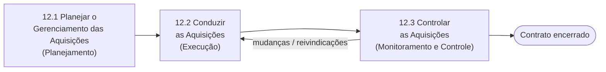
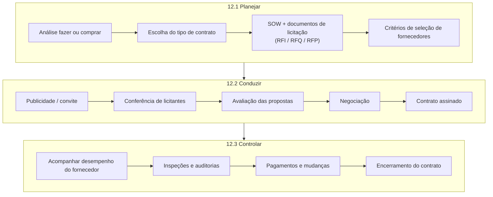

# Gerenciamento de Aquisições — Pesquisa

**Matéria:** Gerenciamento de Software
**Grupo:** Lucas, Rhiady, Jhonatan, João
**Limite:** até 15 slides / 10 a 15 min
**Base principal:** PMBOK Guide 6ª edição (PMI, 2017), capítulo 12 — é a edição que organiza o conteúdo em áreas de conhecimento e processos, como a atividade pede.

---

## 1. Conceito e papel no gerenciamento de projetos

**Definição (PMBOK 6):** o Gerenciamento das Aquisições do Projeto inclui os processos necessários para comprar ou adquirir produtos, serviços ou resultados de fora da equipe do projeto.

Em outras palavras: tudo o que o projeto **não vai fazer sozinho** e precisa contratar de terceiros — e o controle desses contratos do início ao fim.

**Exemplos em projetos de software:**
- Contratar uma fábrica de software ou desenvolvedores terceirizados
- Comprar licenças (banco de dados, IDE, ferramentas de teste)
- Assinar serviços em nuvem (AWS, Azure, Google Cloud) e SaaS (Jira, GitHub, Slack)
- Contratar consultoria (segurança, UX, auditoria)
- Comprar hardware (servidores, dispositivos de teste)

**Papel no projeto:**
- Decide **o que fazer internamente e o que comprar** (análise make-or-buy)
- Formaliza a relação com o fornecedor em um **contrato** (documento legal com obrigações das duas partes)
- Transfere ou divide **riscos** com o fornecedor (o tipo de contrato define quem arca com o prejuízo se o custo subir)
- Conecta-se com as outras áreas: escopo (o que será entregue), custos (quanto), cronograma (quando), qualidade (critérios de aceite), riscos (quem assume) e partes interessadas (o fornecedor é uma delas)

**Ponto de vista:** o PMBOK descreve as aquisições do lado do **comprador**. O fornecedor, do lado dele, pode tratar o contrato como um projeto próprio.

> Observação: a 7ª edição do PMBOK (2021) trocou áreas de conhecimento e processos por princípios e domínios de desempenho; aquisições passaram a aparecer dentro dos domínios de Planejamento e Entrega. Para esta apresentação, a 6ª edição é a referência certa porque o trabalho pede "processos" e a "ordem dos processos".

---

## 2. Processos principais (PMBOK 6)

São **3 processos**, distribuídos em 3 grupos de processos:

| # | Processo | Grupo de processos | O que faz |
|---|----------|--------------------|-----------|
| 12.1 | **Planejar o Gerenciamento das Aquisições** | Planejamento | Decide o que comprar, como comprar, que tipo de contrato usar e como escolher o fornecedor |
| 12.2 | **Conduzir as Aquisições** | Execução | Recebe propostas, seleciona o fornecedor e assina o contrato |
| 12.3 | **Controlar as Aquisições** | Monitoramento e Controle | Acompanha a execução do contrato, aprova mudanças, faz pagamentos e encerra o contrato |

> Na 5ª edição eram 4 processos (havia "Encerrar as Aquisições"). Na 6ª, o encerramento passou a fazer parte de Controlar as Aquisições.

### Ordem dos processos (imagem para o slide)

Versão mais detalhada (com entradas e saídas principais):

Dica: dá para colar o código acima no [mermaid.live](https://mermaid.live) e exportar como PNG para o slide.

### 12.1 Planejar o Gerenciamento das Aquisições
Documenta as decisões de compra, define a abordagem e identifica possíveis fornecedores.

- **Entradas principais:** termo de abertura, documentos de negócio, plano de gerenciamento do projeto (escopo, requisitos), registro de riscos, cronograma, recursos necessários
- **Saídas principais:**
  - Plano de gerenciamento das aquisições
  - Estratégia das aquisições (método de entrega, tipo de contrato, fases)
  - Documentos de licitação: **RFI** (pedido de informação), **RFQ** (pedido de cotação), **RFP** (pedido de proposta)
  - **Declaração do Trabalho (SOW)** — descreve em detalhe o que o fornecedor vai entregar
  - Critérios de seleção de fornecedores
  - Decisões de fazer ou comprar
  - Estimativas independentes de custo (para saber se a proposta é razoável)

### 12.2 Conduzir as Aquisições
Obtém respostas dos fornecedores, seleciona um e adjudica (assina) o contrato.

- **Entradas principais:** plano de aquisições, documentos de licitação, propostas dos fornecedores
- **Saídas principais:** fornecedores selecionados, **acordos/contratos**, solicitações de mudança

### 12.3 Controlar as Aquisições
Gerencia o relacionamento, monitora o desempenho do contrato, faz mudanças e correções e encerra o contrato.

- **Entradas principais:** contratos, relatórios de desempenho do trabalho, solicitações de mudança aprovadas
- **Saídas principais:** **aquisições encerradas**, informações de desempenho, atualizações de documentos

---

## 3. Vantagens e desvantagens

### Vantagens
- **Acesso a especialistas** que a equipe não tem (ex.: segurança, mobile, IA)
- **Ganho de velocidade**: o fornecedor já tem a solução ou a equipe pronta
- **Redução de custo fixo**: paga só pelo que usa (nuvem, SaaS, terceirização por demanda)
- **Transferência de risco**: em contrato de preço fixo, o fornecedor arca com o estouro de custo
- **Foco no essencial**: a equipe interna cuida do que é o diferencial do negócio
- **Previsibilidade e formalização**: o contrato deixa claro escopo, prazo, preço e critérios de aceite
- **Competição** entre fornecedores reduz preço e aumenta qualidade

### Desvantagens
- **Dependência do fornecedor** (vendor lock-in) — difícil trocar depois, principalmente em nuvem e SaaS
- **Menos controle** sobre como o trabalho é feito e sobre a qualidade do código
- **Burocracia e tempo**: planejar, licitar e negociar demora (no setor público, muito mais)
- **Custo de gestão**: alguém precisa acompanhar o contrato o tempo todo
- **Riscos de confidencialidade** e propriedade intelectual (quem é dono do código?)
- **Contrato rígido** atrapalha mudanças de escopo — problema forte em software, onde requisitos mudam
- **Perda de conhecimento**: quando o fornecedor sai, o conhecimento vai junto
- **Disputas e reivindicações** se o contrato for mal escrito

---

## 4. Ferramentas, métodos e técnicas

### Por processo (PMBOK 6)

| Processo | Ferramentas e técnicas |
|----------|------------------------|
| **12.1 Planejar** | Opinião especializada; coleta de dados (pesquisa de mercado); análise de dados (**análise fazer ou comprar**); **análise de seleção de fornecedores**; reuniões |
| **12.2 Conduzir** | Opinião especializada; publicidade; **conferência de licitantes**; análise de dados (**avaliação de propostas**); habilidades interpessoais (**negociação**) |
| **12.3 Controlar** | Opinião especializada; **administração de reivindicações**; análise de dados (**revisões de desempenho**, **análise de valor agregado**, análise de tendências); **inspeção**; **auditorias** |

### Análise fazer ou comprar (make-or-buy)
Compara o custo e o risco de desenvolver internamente contra comprar pronto. Considera custo direto, custo indireto, prazo, capacidade da equipe, risco e importância estratégica.
Exemplo: construir um sistema de login próprio vs. usar Auth0/Firebase Auth.

### Métodos de seleção de fornecedores
- **Menor custo** — para itens padronizados
- **Somente qualificação** — escolhe o mais qualificado, para contratos pequenos
- **Baseado em qualidade / pontuação técnica** — escolhe a melhor técnica e depois negocia preço
- **Qualidade e custo** — pondera os dois (técnica e preço)
- **Fonte única** — só existe um fornecedor possível
- **Orçamento fixo** — o valor é fixo e se escolhe a melhor proposta dentro dele

### Tipos de contrato (tema central — vale um slide próprio)

| Tipo | Como funciona | Risco fica com | Quando usar em software |
|------|---------------|----------------|-------------------------|
| **Preço fixo** (FFP, FPIF, FP-EPA) | Valor fechado pelo escopo | **Fornecedor** | Escopo bem definido (ex.: site institucional) |
| **Custos reembolsáveis** (CPFF, CPIF, CPAF) | Paga os custos reais + taxa/incentivo | **Comprador** | Escopo incerto, pesquisa, inovação |
| **Tempo e material (T&M)** | Paga por hora/pessoa + materiais | Dividido | Alocação de desenvolvedores, sustentação, escopo que muda |

Siglas: FFP = preço fixo garantido; FPIF = preço fixo com incentivo; FP-EPA = preço fixo com ajuste econômico; CPFF = custo + taxa fixa; CPIF = custo + taxa de incentivo; CPAF = custo + taxa de premiação.

### Documentos e técnicas específicos de software
- **SOW / Termo de Referência** com requisitos, critérios de aceite e entregáveis
- **SLA (Acordo de Nível de Serviço)** — disponibilidade, tempo de resposta, multas
- **Ponto de Função** — mede o tamanho do software para pagar por funcionalidade entregue (muito usado no governo brasileiro)
- **Contratos ágeis** — pagamento por sprint ou por entrega, escopo flexível dentro de um orçamento
- **Escrow de código-fonte** — o código fica com um terceiro e é liberado se o fornecedor falir
- **NDA (acordo de confidencialidade)** e cláusulas de **propriedade intelectual**
- **Análise de valor agregado (EVM)** para medir se o fornecedor está no prazo e no custo

### Contexto Brasil (opcional, bom para dar exemplo local)
- Setor público segue a **Lei 14.133/2021** (Nova Lei de Licitações), que define modalidades como pregão e concorrência
- Compras de TI do governo federal seguem regras próprias de contratação de soluções de TIC (normas da Secretaria de Governo Digital)

---

## 5. Exemplo prático

### Opção A (recomendada): HealthCare.gov — fracasso de aquisições (EUA, 2013)
Caso real, muito citado em gerenciamento de projetos de software.

- **O que era:** o site do governo americano para contratação de planos de saúde do "Obamacare"
- **Aquisição:** o órgão responsável (CMS) contratou vários fornecedores; o principal foi a **CGI Federal**, responsável pelo sistema de inscrição, com contrato de **custos reembolsáveis** (custo + taxa)
- **O que deu errado (segundo o GAO, tribunal de contas americano):**
  - **Requisitos indefinidos** — o escopo não estava claro quando o contrato foi assinado
  - **Não havia a estratégia de aquisição**, que era obrigatória
  - **Confusão sobre quem administrava o contrato** dentro do próprio órgão
  - **Ferramentas de fiscalização não foram usadas** — o desempenho do fornecedor não foi acompanhado de verdade
  - Mudanças sem controle: cerca de **40 vezes** os responsáveis autorizaram custos extras sem ter autoridade para isso
  - O tipo de contrato deixou o risco do custo com o governo
- **Números verificados (GAO-14-694):**
  - Custo do trabalho da CGI subiu de **US$ 56 milhões para mais de US$ 209 milhões** (set/2011 a fev/2014), quase 4x
  - O hub de dados (fornecedor QSSI) subiu de US$ 30 milhões para quase US$ 85 milhões
  - O CMS ameaçou reter pagamentos da CGI antes do lançamento, voltou atrás e pagou quase toda a taxa de US$ 12,5 milhões (reteve só US$ 267 mil)
  - Até então, o site já tinha custado cerca de **US$ 840 milhões**
- **Resultado:** o site caiu no lançamento (1º de outubro de 2013). Em janeiro de 2014 a CGI foi substituída pela **Accenture Federal Services**. No fim de 2013 o site já funcionava, e o primeiro período de inscrição terminou com 5,4 milhões de pessoas inscritas (HHS OIG).
- **Conclusão do HHS OIG (2016):** a falha foi principalmente de **gestão e organização**, não só de tecnologia — faltou liderança clara e as decisões atrasaram.
- **Ligação com os processos:**
  - **Planejar:** sem estratégia de aquisição, requisitos indefinidos, contrato que deixou todo o risco com o comprador
  - **Conduzir:** contrato assinado com escopo mal definido
  - **Controlar:** sem fiscalização efetiva, mudanças sem controle, pagamento feito mesmo com entrega ruim
- **Fontes:** [GAO-14-694 (2014)](https://www.gao.gov/assets/gao-14-694.pdf); [HHS OIG OEI-06-14-00350 (2016)](https://oig.hhs.gov/reports/all/2016/healthcaregov-case-study-of-cms-management-of-the-federal-marketplace)

> Não confirmado nas fontes oficiais: o dado de "6 inscritos no primeiro dia" circulou na imprensa em 2013, mas não aparece nos relatórios acima. Melhor não usar, ou citar como "noticiado pela imprensa".

### Opção B: exemplo hipotético de software (fácil de explicar)
Uma startup quer lançar um app de delivery em 6 meses:
1. **Planejar:** análise fazer ou comprar → desenvolve o app internamente, mas **compra** pagamento (Stripe/Mercado Pago), mapas (Google Maps API) e hospedagem (AWS). Para o app mobile, contrata uma fábrica de software com contrato **T&M** porque o escopo vai mudar.
2. **Conduzir:** manda RFP para 3 fábricas, avalia por técnica e preço (peso 60/40), negocia e assina com SLA e cláusula de propriedade do código.
3. **Controlar:** revisões de desempenho a cada sprint, inspeção do código entregue, controle de horas faturadas, encerramento com entrega do código-fonte e documentação.

Sugestão: usar a **Opção A** como caso real (impacta mais) e a **Opção B** em um slide curto para mostrar os três processos aplicados.

---

## 6. Como o gerenciamento eficaz contribui para o sucesso do projeto

- **Custo sob controle:** a escolha certa do contrato e a estimativa independente evitam pagar caro ou estourar o orçamento
- **Prazo cumprido:** cronograma do fornecedor amarrado ao do projeto, com marcos e multas
- **Qualidade garantida:** critérios de aceite e inspeções evitam receber software com defeito
- **Riscos divididos de forma consciente:** o contrato define quem arca com cada risco
- **Menos conflitos:** contrato claro reduz disputas e reivindicações
- **Segurança jurídica e de dados:** NDA, LGPD, propriedade intelectual
- **Relação de parceria:** fornecedor bem gerido entrega mais e vira parceiro de longo prazo
- **Lição do HealthCare.gov:** o software não falhou só por problema técnico, falhou por **aquisição mal planejada e mal controlada**

Frase de fechamento sugerida: *"Em software, quase nenhum projeto é feito 100% em casa. Quem gerencia bem o que compra controla o projeto inteiro."*

---

## 7. Estrutura sugerida (12 slides, ~12 min, ~3 min por pessoa)

| Slide | Conteúdo | Quem |
|-------|----------|------|
| 1 | Capa (tema, grupo, matéria) | Lucas |
| 2 | Conceito: o que é Gerenciamento de Aquisições | Lucas |
| 3 | Papel no projeto + exemplos em software | Lucas |
| 4 | Os 3 processos + **imagem da ordem** | Rhiady |
| 5 | Detalhe: Planejar e Conduzir | Rhiady |
| 6 | Detalhe: Controlar (inclui encerramento) | Rhiady |
| 7 | Vantagens e desvantagens | Jhonatan |
| 8 | Ferramentas e técnicas por processo | Jhonatan |
| 9 | Tipos de contrato (tabela de risco) | Jhonatan |
| 10 | Exemplo prático: HealthCare.gov | João |
| 11 | Como a boa gestão leva ao sucesso | João |
| 12 | Conclusão + referências | João |

---

## Referências
- PMI. *Um Guia do Conhecimento em Gerenciamento de Projetos (Guia PMBOK)*. 6. ed. Newtown Square: PMI, 2017. Cap. 12.
- PMI. *Guia PMBOK*. 7. ed. PMI, 2021.
- U.S. GAO. *Healthcare.gov: Ineffective Planning and Oversight Practices Underscore the Need for Improved Contract Management* (GAO-14-694), 2014.
- U.S. HHS OIG. *HealthCare.gov: Case Study of CMS Management of the Federal Marketplace* (OEI-06-14-00350), 2016.
- BRASIL. Lei nº 14.133, de 1º de abril de 2021 (Nova Lei de Licitações e Contratos).
- VARGAS, Ricardo. *Gerenciamento de Projetos*. Rio de Janeiro: Brasport.
